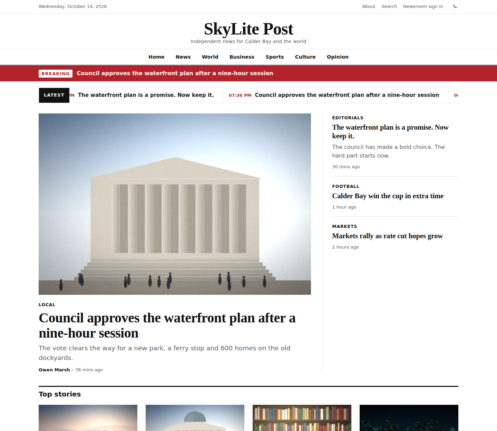
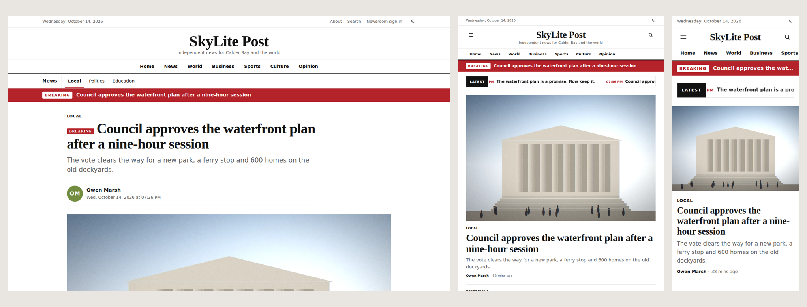
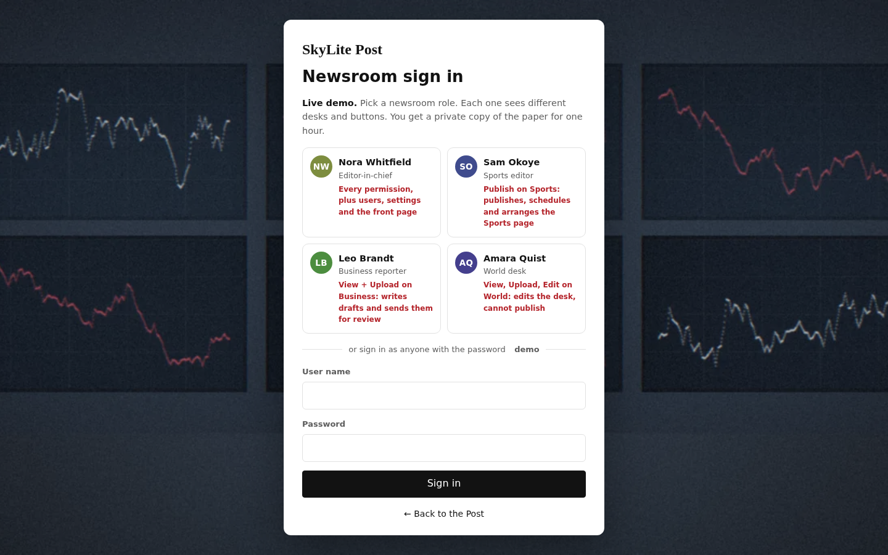
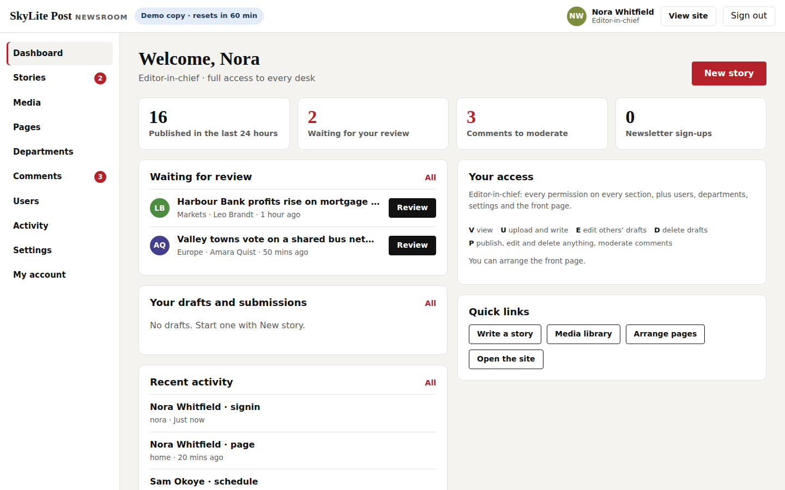
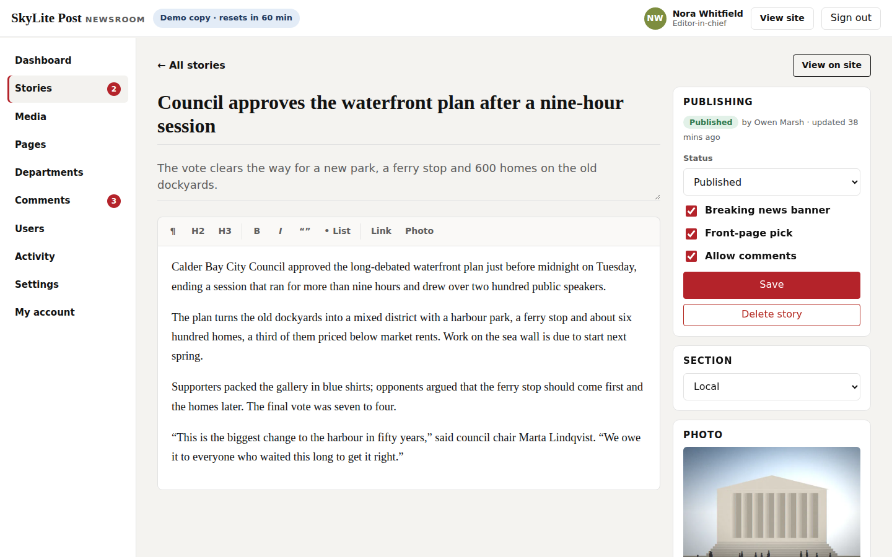
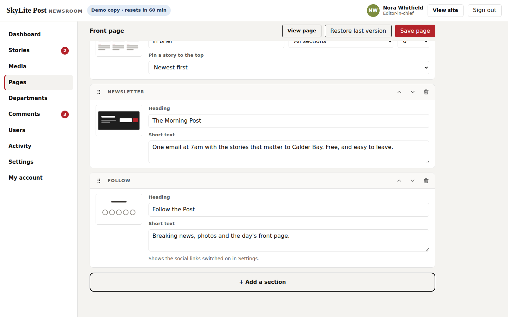
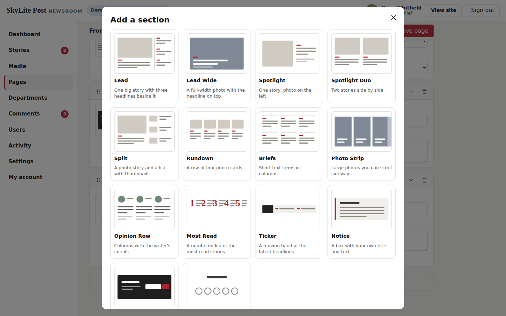
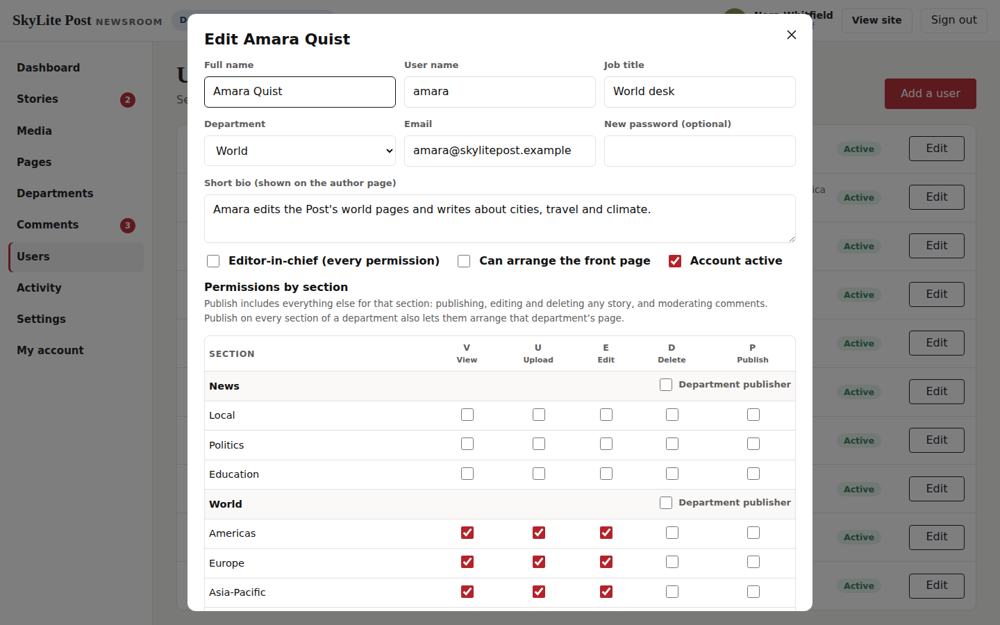
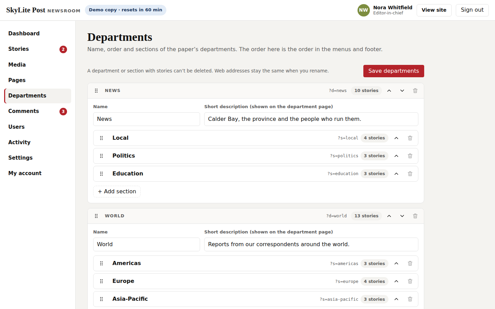

# SkyLite Post — SkyNet Newspaper Template

A responsive daily newspaper with a full newsroom admin, built for **ASP.NET Core (.NET 10)** on the **SkyNet Framework**.
Several editors and reporters work side by side. Each person gets View, Upload, Edit, Delete and Publish rights section by section, and the server checks every action and logs it. Data is stored in JSON files, with no database.
Free and open source. **100% AI-driven coding — built by Claude.**

[](https://dotnet.microsoft.com/)
[](https://www.nuget.org/packages/TheSkyLite.SkyNet)
[](LICENSE)
[](#100-ai-driven-coding)

**Live demo:** https://www.theskylite.com/SkyLitePost — open **Newsroom sign in** at the top and pick a role.



> **Fictional newspaper.** SkyLite Post, Calder Bay and every story, place, person and comment on the site are invented. The photographs are painted in code; there are no stock images.

---

## Features

### Public site (6 pages)

- **Home** (the front page) and **department pages** are stacked from sections arranged in the admin. Each section fills itself with the newest published stories from its source.
- **14 section styles:** Lead, Lead Wide, Spotlight, Spotlight Duo, Split, Rundown, Briefs, Photo Strip, Opinion Row, Most Read, Ticker, Notice, Newsletter and Follow. A story never appears twice on the same page.
- **Section pages** (`Section?s=local`): the lead story, then a list with Load more.
- **Article:** standfirst, byline with author link, local time, photo and caption, tags, a Most read rail, "More in" stories, and comments that wait for an editor's approval.
- **Search** across headlines, tags, sections and text, plus popular tags. **Author** pages and an **About** page with the newsroom staff and contact details.
- **Breaking news** banner, newsletter sign-up, and social links under the footer menu.
- **Light and dark theme.** Responsive layouts for desktop, tablet and phone, with a slide-in section menu on small screens.

### Newsroom admin (12 pages)

- **Sign in.** Each user has their own password (PBKDF2). Failed attempts are throttled per user.
- **Dashboard:**
  - stories waiting for your review, your drafts and submissions;
  - comments to moderate, recent activity;
  - a table of your access, section by section.
- **Stories:**
  - **List:** filter by status (Draft, Ready for review, Scheduled, Published), section or title.
  - **Editor:** headline, standfirst, rich text (headings, bold, italic, quotes, lists, links, photos), section, photo and caption, a video and caption, tags, breaking banner, front-page pick and comments on/off.
  - **Video:** with a photo, the photo leads and the video plays at the end of the article; without a photo, the video leads (poster with a ▶ badge on cards). Videos only play when the reader clicks ▶.
  - **Workflow:** a reporter without Publish rights saves drafts and clicks **Send for review**. An editor with Publish rights publishes, schedules for later, or sends the story back as a draft.
- **Media:** a photo and video library shared by the whole newsroom, with All / Photos / Videos, search, "added by" and paging.
  - **Upload a photo** (collapsible): JPG, PNG or WebP, resized in the browser to 1600 px plus a 720 px thumbnail.
  - **Upload a video** (collapsible): MP4 or WebM up to 50 MB (20 MB in the demo), sent in 2 MB pieces with a progress bar; a still from the first second becomes the poster.
  - Files are checked by content, not by name. A photo or video used by a story can't be deleted until it is removed from the story.
- **Pages:**
  - Pick the front page or a department, then drag sections into order.
  - **Add a section** opens a picker with a thumbnail of each style.
  - For each section, choose the source (all sections, front-page picks, a department or one section), the number of stories, and optionally a story pinned to the top.
  - **Restore last version** undoes the last save.
- **Departments:** add, rename, describe and reorder departments and their sections. Web addresses stay the same after a rename. A department or section that still has stories can't be deleted.
- **Comments:** Waiting and Approved tabs, period, search, section filter and paging; approve, unpublish or delete. Each editor sees only the sections they publish.
- **Users:** add people, set their department, title and bio, and tick **V U E D P** for every section. Shortcuts: "department publisher", editor-in-chief, and the right to arrange the front page.
- **Activity:** every action with who, what and when. Refused attempts are highlighted. The editor-in-chief sees everyone; other users see their own actions.
- **Settings:** name, tagline, accent colour, theme, contact details, About text, comments on/off and 11 social links with a Show tick box.
- **My account:** byline, title, bio and password.

### Permissions

| Letter | Right | What it allows in that section |
|---|---|---|
| **V** | View | See the stories in the admin |
| **U** | Upload | Write new stories, and edit or delete your own drafts |
| **E** | Edit | Edit other people's drafts and stories waiting for review |
| **D** | Delete | Delete other people's drafts |
| **P** | Publish | Everything above, plus: publish and schedule, edit or delete live stories, moderate comments |

- Publish on **every** section of a department also lets the user arrange that department's page.
- The **editor-in-chief** has every right, plus Users, Departments, Settings and the front page.
- Every check runs on the server. A request the user isn't allowed to make is refused and written to the activity log, even if someone crafts it by hand.

### Live demo mode

With `app.app.runmode | 0` the sign-in page shows four newsroom roles:

| Role | Rights |
|---|---|
| **Nora Whitfield**, Editor-in-chief | everything |
| **Sam Okoye**, Sports editor | Publish on Sports |
| **Leo Brandt**, Business reporter | View + Upload on Business |
| **Amara Quist**, World desk | View, Upload, Edit on World |

- Everyone can also sign in with the password `demo`.
- Each visitor gets a **private copy of the paper for one hour**. Sign out and back in as another role to watch a story move from reporter to editor.
- Story dates move forward so the paper always looks fresh.
- Social icons show a note instead of leaving the site.

















- **Painted photographs:** 32 editorial "photos" (city hall, stadium, trading screens, stage, regatta, market tables and more), painted in code by Claude as 64 WebP files, plus two short sample videos.
- **No front-end build:** plain HTML, CSS and vanilla JavaScript; no npm, bundler or SPA framework.
- **No database:** everything lives in four JSON files under `data/`.

---

## Getting started

**Requirements:** .NET 10 SDK and Visual Studio (or any editor with the `dotnet` CLI).

```bash
git clone https://github.com/hkim6000/SkyNet-NewspaperWebsite-Asp.net.Core-Full-Source.git
cd SkyNet-NewspaperWebsite-Asp.net.Core-Full-Source
dotnet run
```

Or open `SkyLitePost.csproj` in Visual Studio and press **F5**.
The SkyNet package (`TheSkyLite.SkyNet` 1.0.6) restores automatically from NuGet.
The app opens on **Home**, the startup page set in `appConfig/application.cfg`.

**Newsroom:** click **Newsroom sign in** (or open `/AdminLogin`) and pick a role.

---

## Run it for real (production mode)

1. **Create a password hash** for the first editor-in-chief. In PowerShell:

   ```powershell
   $p = Read-Host "Password"; [BitConverter]::ToString([Security.Cryptography.SHA256]::Create().ComputeHash([Text.Encoding]::UTF8.GetBytes($p))).Replace("-","").ToLower()
   ```

2. **Edit `appConfig/application.cfg`:**

   ```
   app.app.runmode | 1
   app.admin.user | nora
   app.admin.passhash | <the 64-character hash>
   ```

3. **Sign in as that user.** They become editor-in-chief. Open **Users** and set a real password for each person who needs access.
   - The sample staff start with a "Needs password" flag and can't sign in until you set one.
   - Turn off the accounts you don't need, or rename them.

4. **Give the site write access** to three folders. On IIS, grant the application pool identity (for example `IIS AppPool\SkyLitePost`) **Modify** permission on:

   | Folder | What is written |
   |---|---|
   | `data/` | `site.json`, `pages.json` (+ `pages.prev.json`), `staff.json`, `activity.json`, `views.json` |
   | `temp/` | admin sessions (`temp/admin`) and demo copies (`temp/sandbox`) |
   | `images/uploads/` | photos and videos uploaded in Media |

5. **Use HTTPS.** The session token travels in a cookie and in each admin request.

> **Videos on IIS:** if uploaded videos don't play, make sure the site serves `.mp4` as `video/mp4` and `.webm` as `video/webm` (IIS Manager → MIME Types).

> **Redeploying:** publishing copies the files in `data/` from your project over the live ones. Download the live `data/` folder first (or exclude it from the publish) so you keep the newsroom's work. `images/uploads/` and `temp/` are not published, but turn off "Remove additional files at destination" so they are not deleted.

In production, sessions last 8 hours and renew while you work. Changing a user's password, or turning off their account, signs them out everywhere.

---

## Project structure

```
SkyLitePost/
├── appConfig/application.cfg        app settings, run mode, first editor-in-chief
├── codes/
│   ├── Models/PostModel.cs          data DTOs (Story, Desk, Staff, PageModule, ...)
│   ├── Core/Store.cs                JSON storage, demo copies, view counts
│   ├── Core/Access.cs               V/U/E/D/P checks, passwords, rich-text cleaner
│   ├── Core/Auth.cs                 sessions, admin menu
│   ├── Core/Ui.cs                   section styles, story cards, navigation
│   ├── Core/Social.cs               social icons and links
│   ├── Home.cs  Section.cs  Article.cs  Search.cs  Author.cs  About.cs
│   └── AdminLogin.cs  Admin.cs  AdminArticles.cs  AdminMedia.cs  AdminPages.cs  AdminDesks.cs
│       AdminComments.cs  AdminUsers.cs  AdminActivity.cs  AdminSettings.cs  AdminAccount.cs
├── htmls/  scripts/  styles/        page markup, JavaScript and CSS
├── data/
│   ├── site.json                    settings, departments, stories, comments, media, sign-ups
│   ├── pages.json                   front page and department layouts
│   ├── staff.json                   users, password hashes and permissions
│   └── activity.json                the activity log (latest 5,000)
├── images/news/full/  news/thumbs/  painted photos (1600 px and 720 px, WebP)
├── images/uploads/                  photos uploaded in the admin
├── temp/                            sessions and demo copies (created at run time)
└── Program.cs
```

### One page = four files, one name

| File | Holds |
|---|---|
| `codes/AdminPages.cs` | the page class (`: WebPage`) and its server methods |
| `htmls/AdminPages.html` | markup with `{plhd_*}` placeholders |
| `scripts/AdminPages.js` | one IIFE namespace, `AdminPagesJs` |
| `styles/AdminPages.css` | styles, every class prefixed (`pg-`) |

---

## SkyNet in action

The browser calls a C# method, the method returns an `ApiResponse`, and only those parts of the page change.

```js
// scripts/AdminArticles.js
api('Save', [{ key: 'sid', vlu: val('ed-sid') }, { key: 'status', vlu: val('ed-status') }, ...]);
```

```csharp
// codes/AdminArticles.cs
if ((status == "published" || status == "scheduled") && !Access.Can(c.U, section, 'P'))
{
    return await Refuse(response, c, "publish", id, "Publishing needs Publish rights on " + name + ".");
}
...
response.ExecuteScript("AdminArticlesJs.toast('Published');");
```

| Page | Requests |
|---|---|
| every public page | `Hydrate` (the visitor's demo copy), `Subscribe` |
| Section | `More` |
| Article | `Comment` |
| AdminLogin | `SignIn` |
| AdminArticles | `Load`, `List`, `Edit`, `Save`, `Delete` |
| AdminMedia | `Upload`, `Remove` |
| AdminPages | `Card`, `Pins`, `Save`, `Restore` |
| AdminDesks | `Save` |
| AdminComments | `Moderate` |
| AdminUsers | `Form`, `SaveUser` |
| AdminSettings / AdminAccount | `Save` / `Profile`, `Password` |

Learn more: [SkyNet Developer Guide](https://www.theskylite.com/documents/SkyNet_Developer_Guide.html)

---

## Customize it

- **In the admin:** departments, sections, page layouts, stories, photos, users, rights and settings. No code needed.
- **Starting content:** replace the four files in `data/` to ship your own defaults.
- **Fonts and colours:** the CSS variables at the top of each stylesheet (`--hm-head`, `--hm-text`, `--hm-ink`, ...). The accent colour comes from Settings.
- **New section styles:** add a case to `Ui.Module` in `codes/Core/Ui.cs`, an entry in `Ui.Styles`, and its CSS.

> Comments and newsletter sign-ups are stored in `site.json`; nothing is emailed. Article views are counted in `data/views.json`.

---

## 100% AI-driven coding

Every file in this template was generated by Claude (Anthropic's AI) from short instructions, directed and reviewed by the author: C#, HTML, CSS, JavaScript, the painted photographs and the data.
No line was written by hand.

| | |
|---|---|
| Pages | 18 (6 public, 12 admin) |
| Lines of code | ~14,600 (C#, HTML, CSS, JavaScript) |
| Images | 32 painted photos (64 WebP) |
| Departments / sections / stories | 6 / 16 / 52 |
| Lines written by hand | 0 |

SkyNet's page model is small and predictable: one class, four files, `$ApiRequest` → `ApiResponse`.
With so few, consistent rules, AI can generate complete, working pages with very few errors.

---

## License

- **This template** (all source files, artwork and data in this repository): [MIT License](LICENSE). Free to use, modify and redistribute, including commercially.
- **SkyNet Framework** (`TheSkyLite.SkyNet` NuGet package): proprietary, free to use for eligible users including commercial use; see the license included in the package.

---

## Links

- Live demo: https://www.theskylite.com/SkyLitePost
- SkyNet Framework: https://www.theskylite.com
- NuGet package: https://www.nuget.org/packages/TheSkyLite.SkyNet
- SkyNet Agent (build your own site with Claude Code): https://github.com/hkim6000/SkyNet-Agent
- Template #1 — Beauty store: https://github.com/hkim6000/SkyNet-BeautyWebsite-Asp.net.Core-Full-Source
- Template #2 — Pharma company: https://github.com/hkim6000/SkyNet-PharmaWebsite-Asp.net.Core-Full-Source
- Template #3 — Travel blog: https://github.com/hkim6000/SkyNet-TravelWebsite-Asp.net.Core-Full-Source
- Template #4 — Fast food restaurant: https://github.com/hkim6000/SkyNet-FastFoodWebsite-Asp.net.Core-Full-Source
- Template #5 — Fine dining restaurant: https://github.com/hkim6000/SkyNet-FineDiningWebsite-Asp.net.Core-Full-Source
- Template #6 — Car dealership: https://github.com/hkim6000/SkyNet-CarDealerWebsite-Asp.net.Core-Full-Source
- Template #7 — Web comic: https://github.com/hkim6000/SkyNet-WebComicWebsite-Asp.net.Core-Full-Source
- Template #8 — Art gallery: https://github.com/hkim6000/SkyNet-ArtGalleryWebsite-Asp.net.Core-Full-Source
- Template #9 — Artist blog: https://github.com/hkim6000/SkyNet-ArtistBlogWebsite-Asp.net.Core-Full-Source
- SkyNet project template: https://github.com/hkim6000/ASPNETCoreEmpty.SkyNet

© 2026 HC Kim
